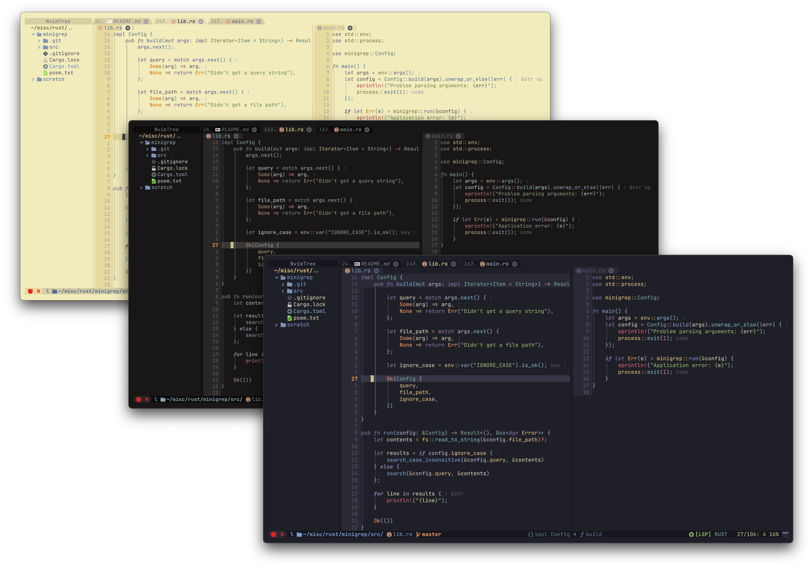

<h3>Kanagawa for <a href="https://neovim.io/">Neovim</a></h3>
<p>A community-maintained theme inspired by Hokusai's <em>The Great Wave off Kanagawa</em>.</p>
<p>Original <a href="https://github.com/rebelot/kanagawa.nvim">theme and palette</a> by <a href="https://github.com/rebelot">rebelot</a>.</p>

<p>
  <a href="https://github.com/kanagawa-community/neovim/stargazers">
    <picture>
      <source media="(prefers-color-scheme: dark)" srcset="https://img.shields.io/github/stars/kanagawa-community/neovim?style=for-the-badge&amp;labelColor=1F1F28&amp;color=E6C384">
      <source media="(prefers-color-scheme: light)" srcset="https://img.shields.io/github/stars/kanagawa-community/neovim?style=for-the-badge&amp;labelColor=F2ECBC&amp;color=77713F">
      
    </picture>
  </a>
  <a href="https://github.com/kanagawa-community/neovim/releases/latest">
    <picture>
      <source media="(prefers-color-scheme: dark)" srcset="https://img.shields.io/github/v/release/kanagawa-community/neovim?style=for-the-badge&amp;label=release&amp;labelColor=1F1F28&amp;color=7E9CD8">
      <source media="(prefers-color-scheme: light)" srcset="https://img.shields.io/github/v/release/kanagawa-community/neovim?style=for-the-badge&amp;label=release&amp;labelColor=F2ECBC&amp;color=4D699B">
      
    </picture>
  </a>
  <a href="https://github.com/kanagawa-community/neovim/issues">
    <picture>
      <source media="(prefers-color-scheme: dark)" srcset="https://img.shields.io/github/issues/kanagawa-community/neovim?style=for-the-badge&amp;labelColor=1F1F28&amp;color=C34043">
      <source media="(prefers-color-scheme: light)" srcset="https://img.shields.io/github/issues/kanagawa-community/neovim?style=for-the-badge&amp;labelColor=F2ECBC&amp;color=C84053">
      
    </picture>
  </a>
</p>

<br clear="both">
<br>

**Highlights:** [Three variants](#variants) ·
[Configurable colors and highlights](#customization) ·
[Plugin integrations](#integration) · [Options](#configuration)

## Preview



## Features

- Tree-sitter syntax highlighting and support for many popular plugins.
- Optional Lua bytecode compilation for faster startup.

## Installation

Choose a plugin manager and add Kanagawa to your Neovim configuration.

### `vim.pack` (Neovim 0.12+)

Neovim's built-in plugin manager is experimental. Add this to your `init.lua`:

```lua
vim.pack.add({
    { src = "https://github.com/kanagawa-community/neovim", name = "kanagawa" },
})
```

### [lazy.nvim](https://github.com/folke/lazy.nvim)

Add this plugin spec:

```lua
{
    "kanagawa-community/neovim",
    name = "kanagawa",
    lazy = false,
    priority = 1000,
}
```

### [packer.nvim](https://github.com/wbthomason/packer.nvim)

For existing Packer configurations:

```lua
use { "kanagawa-community/neovim", as = "kanagawa" }
```

## Requirements

- neovim latest
- truecolor terminal support
- undercurl terminal support (optional)

## Usage

Set the colorscheme in your Neovim configuration:

```vim
colorscheme kanagawa
```

```lua
vim.cmd("colorscheme kanagawa")
```

## Configuration

Call `setup` only if you want to change the defaults.

```lua
-- Default options:
require('kanagawa').setup({
    compile = false,             -- enable compiling the colorscheme
    undercurl = true,            -- enable undercurls
    commentStyle = { italic = true },
    functionStyle = {},
    keywordStyle = { italic = true},
    statementStyle = { bold = true },
    typeStyle = {},
    transparent = false,         -- do not set background color
    dimInactive = false,         -- dim inactive window `:h hl-NormalNC`
    terminalColors = true,       -- define vim.g.terminal_color_{0,17}
    colors = {                   -- add/modify theme and palette colors
        palette = {},
        theme = { wave = {}, lotus = {}, dragon = {}, all = {} },
    },
    overrides = function(colors) -- add/modify highlights
        return {}
    end,
    theme = "wave",              -- Load "wave" theme
    background = {               -- map the value of 'background' option to a theme
        dark = "wave",           -- try "dragon" !
        light = "lotus"
    },
})

-- setup must be called before loading
vim.cmd("colorscheme kanagawa")
```

If you enable compilation, run `:KanagawaCompile` after each configuration change.

```vim
" 1. Modify your config
" 2. Restart nvim
" 3. Run this command:
:KanagawaCompile
```

Kanagawa uses the values of `'laststatus'` and `'cmdheight'` during setup, so set both options before calling `setup`.

## Variants

Kanagawa supports three variants:

- 🌊 **Wave** (`wave`), the default dark variant.
- 🐉 **Dragon** (`dragon`), a darker, muted variant.
- 🪷 **Lotus** (`lotus`), the light variant.

Variants can be changed in three ways:

- Setting `config.theme` to the desired theme.
- Using the `background` option:
  Any change to the value of `vim.o.background` will select the theme mapped by `config.background`.
- Loading the colorscheme directly with:

  ```lua
  vim.cmd("colorscheme kanagawa-wave")
  vim.cmd("colorscheme kanagawa-dragon")
  vim.cmd("colorscheme kanagawa-lotus")
  ```

  or

  ```lua
  require("kanagawa").load("wave")
  ```

## Customization

Kanagawa separates palette values from semantic theme colors. `PaletteColors`
are RGB hex values named for their appearance. `ThemeColors` use semantic names
grouped by function.

The `palette` defines available colors. A `theme` maps palette colors to
semantic theme colors, and can use one palette color for multiple purposes.

Use `config.colors` to change palette values and theme colors.
See [the palette color names](lua/kanagawa/colors.lua) and
[how each theme uses them](lua/kanagawa/themes.lua).

```lua
require('kanagawa').setup({
    ...,
    colors = {
        palette = {
            -- change all usages of these colors
            sumiInk0 = "#000000",
            fujiWhite = "#FFFFFF",
        },
        theme = {
            -- change specific usages for a certain theme, or for all of them
            wave = {
                ui = {
                    float = {
                        bg = "none",
                    },
                },
            },
            dragon = {
                syn = {
                    parameter = "yellow",
                },
            },
            all = {
                ui = {
                    bg_gutter = "none"
                }
            }
        }
    },
    ...
})
```

Use `config.overrides` to change built-in or plugin highlight groups. See
`:help highlight` for details about highlight groups. Supported keywords match
the `{val}` parameter of `:h nvim_set_hl`.

```lua
require('kanagawa').setup({
    ...,
    overrides = function(colors)
        return {
            -- Assign a static color to strings
            String = { fg = colors.palette.carpYellow, italic = true },
            -- theme colors will update dynamically when you change theme!
            SomePluginHl = { fg = colors.theme.syn.type, bold = true },
        }
    end,
    ...
})
```

### Common customizations

#### Remove _gutter_ background

Remove the background of `LineNr`, `{Sign,Fold}Column` and friends

```lua
colors = {
    theme = {
        all = {
            ui = {
                bg_gutter = "none"
            }
        }
    }
}
```

#### Add gutter indications for treesitter-context

Italicize and dim line numbers that belong to the
[treesitter-context](https://github.com/nvim-treesitter/nvim-treesitter-context/)
context.

```lua
overrides = function(colors)
    local theme = colors.theme
    return {
          -- Dim gutter background for treesitter-context line numbers
          TreesitterContextLineNumber = { bg = theme.ui.bg_dim, fg = theme.ui.nontext, italic = true }
    }
end,
```

#### Transparent Floating Windows

Set transparent backgrounds on floating windows while keeping their default borders.

```lua
overrides = function(colors)
    local theme = colors.theme
    return {
        NormalFloat = { bg = "none" },
        FloatBorder = { bg = "none" },
        FloatTitle = { bg = "none" },

        -- Save an hlgroup with dark background and dimmed foreground
        -- so that you can use it where your still want darker windows.
        -- E.g.: autocmd TermOpen * setlocal winhighlight=Normal:NormalDark
        NormalDark = { fg = theme.ui.fg_dim, bg = theme.ui.bg_m3 },

        -- Popular plugins that open floats will link to NormalFloat by default;
        -- set their background accordingly if you wish to keep them dark and borderless
        LazyNormal = { bg = theme.ui.bg_m3, fg = theme.ui.fg_dim },
        MasonNormal = { bg = theme.ui.bg_m3, fg = theme.ui.fg_dim },
    }
end,
```

To keep floating windows dark and change how borders look, use characters drawn
at the edges of the box:

```lua
{ "🭽", "▔", "🭾", "▕", "🭿", "▁", "🭼", "▏" }
```

#### Borderless Telescope

Create a block-style Telescope interface.

```lua
overrides = function(colors)
    local theme = colors.theme
    return {
        TelescopeTitle = { fg = theme.ui.special, bold = true },
        TelescopePromptNormal = { bg = theme.ui.bg_p1 },
        TelescopePromptBorder = { fg = theme.ui.bg_p1, bg = theme.ui.bg_p1 },
        TelescopeResultsNormal = { fg = theme.ui.fg_dim, bg = theme.ui.bg_m1 },
        TelescopeResultsBorder = { fg = theme.ui.bg_m1, bg = theme.ui.bg_m1 },
        TelescopePreviewNormal = { bg = theme.ui.bg_dim },
        TelescopePreviewBorder = { bg = theme.ui.bg_dim, fg = theme.ui.bg_dim },
    }
end,
```

#### Dark completion (popup) menu

Use a more uniform color scheme for the popup menu.

```lua
overrides = function(colors)
    local theme = colors.theme
    return {
        Pmenu = { fg = theme.ui.shade0, bg = theme.ui.bg_p1 },  -- add `blend = vim.o.pumblend` to enable transparency
        PmenuSel = { fg = "NONE", bg = theme.ui.bg_p2 },
        PmenuSbar = { bg = theme.ui.bg_m1 },
        PmenuThumb = { bg = theme.ui.bg_p2 },
    }
end,
```

#### Tint background of diagnostic messages with their foreground color

This gives diagnostic messages a tinted background, similar to
[tokyonight.nvim](https://github.com/folke/tokyonight.nvim).

```lua
overrides = function(colors)
  local theme = colors.theme
  local makeDiagnosticColor = function(color)
    local c = require("kanagawa.lib.color")
    return { fg = color, bg = c(color):blend(theme.ui.bg, 0.95):to_hex() }
  end

  return {
    DiagnosticVirtualTextHint  = makeDiagnosticColor(theme.diag.hint),
    DiagnosticVirtualTextInfo  = makeDiagnosticColor(theme.diag.info),
    DiagnosticVirtualTextWarn  = makeDiagnosticColor(theme.diag.warning),
    DiagnosticVirtualTextError = makeDiagnosticColor(theme.diag.error),
  }
end
```

## Integration

### Get palette and theme colors

```lua
-- Get the colors for the current theme
local colors = require("kanagawa.colors").setup()
local palette_colors = colors.palette
local theme_colors = colors.theme

-- Get the colors for a specific theme
local wave_colors = require("kanagawa.colors").setup({ theme = 'wave' })
```

### Terminal integration

Change Kitty's theme when Neovim's colorscheme changes:

```lua
vim.api.nvim_create_autocmd("ColorScheme", {
    pattern = "kanagawa",
    callback = function()
        if vim.o.background == "light" then
            vim.fn.system("kitty +kitten themes Kanagawa_light")
        elseif vim.o.background == "dark" then
            vim.fn.system("kitty +kitten themes Kanagawa_dragon")
        else
            vim.fn.system("kitty +kitten themes Kanagawa")
        end
    end,
})
```

## Wave color palette

<details>
<summary>Show Wave palette color table</summary>

|                         Swatch                          | Name          |    Hex    | Usage                                                                             |
| :-----------------------------------------------------: | :------------ | :-------: | :-------------------------------------------------------------------------------- |
|      | fujiWhite     | `#DCD7BA` | Default foreground                                                                |
|       | oldWhite      | `#C8C093` | Dark foreground (statuslines)                                                     |
|       | sumiInk0      | `#16161D` | Dark background (statuslines and floating windows)                                |
|       | sumiInk1      | `#1F1F28` | Default background                                                                |
|       | sumiInk2      | `#2A2A37` | Lighter background (colorcolumn, folds)                                           |
|       | sumiInk3      | `#363646` | Lighter background (cursorline)                                                   |
|       | sumiInk4      | `#54546D` | Darker foreground (line numbers, fold column, non-text characters), float borders |
|      | waveBlue1     | `#223249` | Popup background, visual selection background                                     |
|      | waveBlue2     | `#2D4F67` | Popup selection background, search background                                     |
|    | winterGreen   | `#2B3328` | Diff Add (background)                                                             |
|   | winterYellow  | `#49443C` | Diff Change (background)                                                          |
|      | winterRed     | `#43242B` | Diff Deleted (background)                                                         |
|    | winterBlue    | `#252535` | Diff Line (background)                                                            |
|    | autumnGreen   | `#76946A` | Git Add                                                                           |
|      | autumnRed     | `#C34043` | Git Delete                                                                        |
|   | autumnYellow  | `#DCA561` | Git Change                                                                        |
|     | samuraiRed    | `#E82424` | Diagnostic Error                                                                  |
|    | roninYellow   | `#FF9E3B` | Diagnostic Warning                                                                |
|      | waveAqua1     | `#6A9589` | Diagnostic Info                                                                   |
|    | dragonBlue    | `#658594` | Diagnostic Hint                                                                   |
|       | fujiGray      | `#727169` | Comments                                                                          |
|  | springViolet1 | `#938AA9` | Light foreground                                                                  |
|      | oniViolet     | `#957FB8` | Statements and Keywords                                                           |
|    | crystalBlue   | `#7E9CD8` | Functions and Titles                                                              |
|  | springViolet2 | `#9CABCA` | Brackets and punctuation                                                          |
|    | springBlue    | `#7FB4CA` | Specials and builtin functions                                                    |
|      | lightBlue     | `#A3D4D5` | Not used                                                                          |
|      | waveAqua2     | `#7AA89F` | Types                                                                             |
|    | springGreen   | `#98BB6C` | Strings                                                                           |
|   | boatYellow1   | `#938056` | Not used                                                                          |
|   | boatYellow2   | `#C0A36E` | Operators, RegEx                                                                  |
|     | carpYellow    | `#E6C384` | Identifiers                                                                       |
|     | sakuraPink    | `#D27E99` | Numbers                                                                           |
|        | waveRed       | `#E46876` | Standout specials 1 (builtin variables)                                           |
|      | peachRed      | `#FF5D62` | Standout specials 2 (exception handling, return)                                  |
|  | surimiOrange  | `#FFA066` | Constants, imports, booleans                                                      |
|    | katanaGray    | `#717C7C` | Deprecated                                                                        |

</details>

## Accessibility

Contrast depends on the foreground and background colors used together. A theme
cannot guarantee WCAG compliance in every interface, so test each pair used for
text or controls. [WCAG 2.1 Level AA contrast requirements](https://www.w3.org/TR/WCAG21/#contrast-minimum)
specify at least `4.5:1` for normal text and `3:1` for large text.
[WCAG guidance on use of color](https://www.w3.org/TR/WCAG21/#use-of-color)
also says not to use color alone to communicate meaning.

## Extras

We are migrating these extras, so their links and availability may change.

- [Alacritty](extras/alacritty/)
- [Alfred](extras/alfred.md)
- [Base16](extras/base16/)
- [Broot](extras/broot/)
- [Emacs](extras/emacs/)
- [Fish](extras/fish/) (also available as a [plugin](https://github.com/nakulj/kanagawa.fish))
- [Foot](extras/foot/)
- [iTerm](extras/iterm/)
- [Kitty](extras/kitty/)
- [Mintty](extras/mintty/)
- [Ptyxis](extras/ptyxis/)
- [Pywal](extras/pywal/)
- [Sway](extras/sway/)
- [Wezterm](extras/wezterm/)
- [Windows Terminal](extras/windows-terminal/)
- [Ghostty](extras/ghostty)
- [Xresources](extras/xresources/)
- [tmTheme (Sublime Text, bat and delta)](extras/tmTheme/)
- [JSON compatible with many terminals](extras/gogh/) Check [Gogh](https://github.com/Gogh-Co/Gogh#-terminals) for the list of supported terminals.
- Bonus: use the [Python script to extract a color palette](palette.py) from an image.

Run the following command to generate new extra themes from the kanagawa plugin directory:

```sh
    nvim --headless "+lua require('kanagawa.extra').setup()" +qa
```

## Acknowledgements

- [Tokyonight](https://github.com/folke/tokyonight.nvim)
- [Gruvbox](https://github.com/morhetz/gruvbox)
- [Catppuccin](https://github.com/catppuccin/nvim)
- [Affinity Designer](https://affinity.serif.com/designer/)

### Support upstream

Support the original Kanagawa author, Tommaso Laurenzi:

[](https://www.paypal.com/donate/?business=VNQPHGW4JEM3S&no_recurring=0&item_name=Buy+me+coffee+and+support+my+work+%3B%29&currency_code=EUR)
